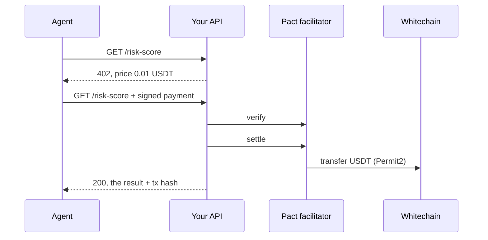

x402 is a standard for paying over HTTP. Your API answers `402 Payment Required` with a price. The agent pays in USDT, retries with the payment attached, and gets the result. No accounts, no API keys, no invoices.

Pact runs an x402 **facilitator** on Whitechain that settles **real USDT** with Permit2 (the `exact` and `upto` schemes). It works with the official `@x402/*` packages unchanged.

<Frame caption="Agents: calls, spend and limits">
  
</Frame>

## How a paid call works



## Sell an endpoint

Put a Hono route behind a price with `@x402/hono`:

```ts server.ts
import { Hono } from 'hono';
import { paymentMiddleware, x402ResourceServer } from '@x402/hono';
import { HTTPFacilitatorClient } from '@x402/core/server';
import { ExactEvmScheme } from '@x402/evm/exact/server';

const app = new Hono();
const facilitator = new HTTPFacilitatorClient({
  url: 'https://api.pactagent.app',
  createAuthHeaders: async () => ({
    verify: { Authorization: `Bearer ${process.env.PACT_SECRET_KEY}` },
    settle: { Authorization: `Bearer ${process.env.PACT_SECRET_KEY}` },
    supported: {},
  }),
});
const server = new x402ResourceServer(facilitator)
  .register('eip155:1874', new ExactEvmScheme());
await server.initialize();

app.use(
  paymentMiddleware(
    {
      'GET /risk-score': {
        accepts: {
          scheme: 'exact',
          network: 'eip155:1874',
          price: {
            asset: process.env.USDT_ADDRESS as `0x${string}`, // test USDT
            amount: '10000', // 0.01 USDT in minor units
            extra: { assetTransferMethod: 'permit2' },
          },
          payTo: process.env.MERCHANT_ADDRESS as `0x${string}`,
          maxTimeoutSeconds: 120,
        },
      },
    },
    server,
  ),
);

app.get('/risk-score', c => c.json({ address: c.req.query('address'), score: 12 }));
```

Pact's own agent runner records its calls under **Agents** in the dashboard. If you protect your own API with this middleware, keep your own call and settlement records; those external calls are not automatically added to Pact's dashboard or [export](/merchant/exports).

The facilitator checks that the bearer secret key belongs to the `payTo` merchant address. Keep the key on this server. Get the address from `GET /v1/config` with that key.

## Pay from an agent

This raw-key example assumes the payer already holds test USDT and has approved that token for Permit2 on Whitechain. The initial approval is an onchain transaction; `@x402/evm/exact/client` exports `createPermit2ApprovalTx` to build it. Pact's agent-account flow instead uses a funded account and a session signer with onchain limits.

```ts agent.ts
import { decodePaymentResponseHeader, wrapFetchWithPayment, x402Client } from '@x402/fetch';
import { ExactEvmScheme } from '@x402/evm/exact/client';
import { privateKeyToAccount } from 'viem/accounts';

const account = privateKeyToAccount(process.env.AGENT_KEY as `0x${string}`);
const client = x402Client.fromConfig({
  schemes: [{ network: 'eip155:1874', client: new ExactEvmScheme(account) }],
});
const pay = wrapFetchWithPayment(fetch, client);

for (let i = 0; i < 10; i++) {
  const res = await pay('https://shop.example.com/risk-score?address=0x…');
  const header = res.headers.get('payment-response');
  console.log(res.status, header ? decodePaymentResponseHeader(header) : null);
}
```

## Agent accounts and spending limits

An agent shouldn't hold an open wallet. Its owner creates an **agent account** (`X402AgentAccount`) on Whitechain, tops it up with USDT, and sets a session for the agent:

| Limit | Example |
| --- | --- |
| Max per call | 0.05 USDT |
| Max per day | 1.00 USDT |
| Allowed merchants | The merchant's onchain address, for example `0x1234…` |
| Expires | In 7 days |

The owner signs the session once; Pact relays it, so the owner needs no WBT. The account contract refuses any payment that breaks a limit, so an 11th call over the daily limit fails without spending anything. Reservations are simulated first, so refusals cost no gas.

The account works like prepaid credits: the balance goes down with each call, and the owner tops up when it runs low.

## Facilitator endpoints

| Endpoint | |
| --- | --- |
| `GET /supported` | Schemes and networks (`exact`, `upto` on `eip155:1874`) |
| `POST /verify` | Check a payment without settling it |
| `POST /settle` | Settle it onchain |
| `GET /health` | |

Base URL: `https://api.pactagent.app`.

## Try it

- The [demo](https://demo.pactagent.app): **AI agent** pays 10 calls, then the 11th is refused.
- From the repository: `pnpm --dir apps/api exec tsx scripts/live/smoke-agents.ts`.
