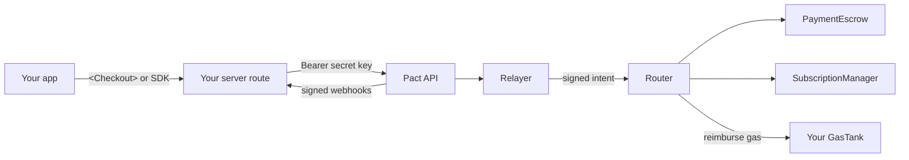

This page is reference for your coding agent and developers. To have an agent do the integration for you, start with [Integrate with your agent](/agents/overview).

## The pieces



| Piece | What it does |
| --- | --- |
| **Checkout** | React and Expo components, or the hosted checkout at `pay.pactagent.app`. The customer signs in with email. |
| **Pact API** | `https://api.pactagent.app`. Creates payments, refunds, plans and invoices, and sends webhooks. |
| **Relayer** | Sends the customer's signed intent to the chain and pays the gas up front. Simulates every call first. |
| **Router** | Checks the signature, nonce, deadline, allowlist and caps, runs the call, and takes the gas back from your tank. |
| **PaymentEscrow** | Holds and settles one-time payments and refunds. |
| **SubscriptionManager** | Stores mandates and refuses renewals that break them. |
| **Keeper** | Charges renewals when they are due. |
| **Indexer** | Reads contract events and turns them into orders, ledger rows and webhooks. |

## The life of a payment

1. Your server creates a payment for 20.00 USDT.
2. The customer signs in with email on the checkout and clicks **Pay**. Their account signs an EIP-712 intent.
3. The relayer simulates the call, then sends it to the Router.
4. The Router checks the rules, moves the USDT through PaymentEscrow, and reimburses the gas from your tank.
5. The indexer sees the event and sends `payment.captured` to your webhook. A product order also sends `order.paid`.
6. You fulfil the order.

Your server creates the payment in step 1 and fulfils the order in step 6. Fulfil from a verified webhook or a server-side payment lookup, not a browser callback alone.

## API keys

Create keys under **Integration → API keys**.

| Key | Prefix | Where it goes |
| --- | --- | --- |
| Secret key | `sk_test_…` | Your server only. Never in a browser or app bundle. |
| Webhook secret | `whsec_…` | Your server only, to verify webhooks. |

Every API call sends the secret key as a bearer token:

```bash
curl https://api.pactagent.app/v1/payments \
  -H "Authorization: Bearer $PACT_SECRET_KEY"
```

## Packages

| Package | Use it for |
| --- | --- |
| `@pactagent/core` | The typed client and transports, shared by everything else |
| `@pactagent/node` | Your server: payments, refunds, plans, exports, webhook verification |
| `@pactagent/checkout-react` | The `<Checkout>` component for web apps |
| `@pactagent/react-native` | The `PactCheckout` component for Expo apps |

```bash
pnpm add @pactagent/core @pactagent/node @pactagent/checkout-react
```

<Note>The `@pactagent/*` packages have been renamed in this repository but have not been published to npm yet. Until they are published, use the workspace example or a hosted checkout link.</Note>

## Sample apps

- `examples/merchant-store` in this repository: a Next.js store with a restricted `/api/pact` route. It uses the workspace SDK and fulfils an order after verifying its payment on the server; its webhook route verifies signed events.
- The [demo](https://demo.pactagent.app) shows every role with sample data.

## Next

<CardGroup cols={2}>
  <Card title="Embedded checkout" icon="code" href="/integrate/embedded-checkout" />
  <Card title="Webhooks" icon="bell" href="/integrate/webhooks" />
</CardGroup>
